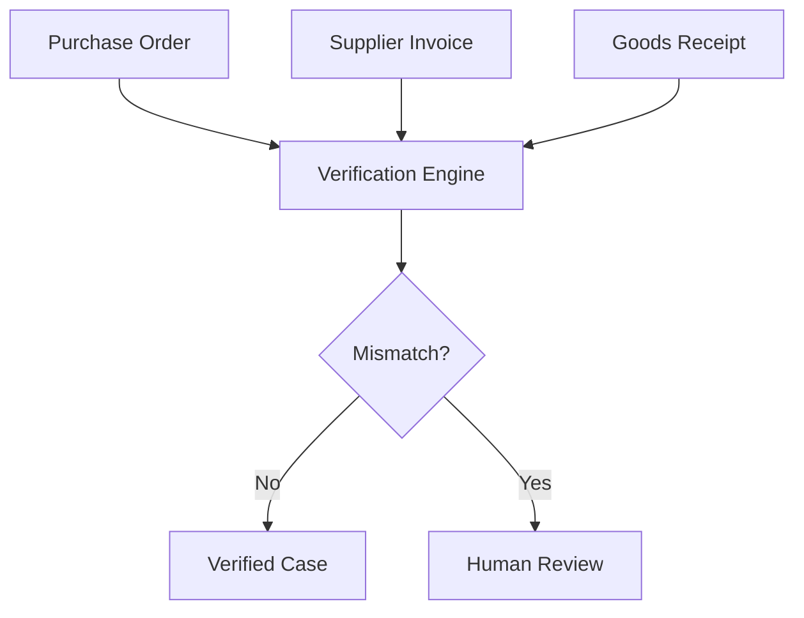

ProofFlow does have agent in self-improvement agnet  and a connection so that other app can connect adn also can talk with data , make diagrams, charts, graphs, etc

## Response:
10/11/2026, 3:44:36 PM · gpt-6-thinking

Yes—those capabilities can fit together, but I’d structure ProofFlow as a focused agentic data platform rather than a document extractor with unrelated features. I’ll map out the agents, the controlled self-improvement loop, app integrations, and how natural-language questions become verified charts, diagrams, and actions.

> **Defining ProofFlow capabilities**
>
> I’m interpreting ProofFlow as an extensible agent platform with connectors for other applications, conversational data analysis, and automatic diagrams, charts, and graphs. I’ll frame self-improvement as monitored, evaluated, and human-approved rather than uncontrolled self-modification.
>
> **Defined ProofFlow capabilities**
>
> 
>
> **Designing ProofFlow’s agent layer**
>
> I’m defining ProofFlow as an extensible platform: agents connect external applications, converse with governed data, and generate validated diagrams, charts, graphs, and workflows. Self-improvement should be evaluated, versioned, and reviewable—not uncontrolled.
>
> **Expanding ProofFlow’s platform**
>
> I’m shaping ProofFlow into an agentic data and workflow platform with external connections, governed data conversations, automatic visualizations, and a measured improvement loop spanning corrections, evaluations, versioning, and rollback.
>
> **Designed ProofFlow’s agent layer and expanded its platform**
>
> 
>
> **Searched 4 websites**
>
> 
>
> Worked for 29s

Yes. I would expand **ProofFlow** into a much more capable product that combines **AI agents, controlled self-improvement, external app connectivity, conversational data analytics, and interactive visualizations**\.

However, I would keep document intelligence and business verification as its initial specialization. Otherwise, it risks becoming another general-purpose AI chat application.

# ProofFlow AI - Agentic Data Intelligence Platform

Proposed product architecture · 2026-2030

**Vision\:** Connect business data, understand documents, answer questions, generate insights, visualize relationships, and safely execute actions-with an AI system that measurably improves over time.

## 1\. The six core capabilities

**1\. Agentic reasoning and workflows**

Agents plan multi-step tasks, choose tools, analyze information, verify findings, and coordinate actions. They can pause for approvals and resume after failures.

**2\. Self-improvement engine**

Learns from corrections and measured failures, evaluates alternative prompts/models, and proposes improvements. Deployments and fine-tuning require explicit validation.

**3\. Universal connectivity**

Connects to databases, external APIs, document repositories, and business software. Other applications can access ProofFlow through REST APIs, webhooks, and MCP.

**4\. Talk with your data**

Ask natural-language questions across structured records and documents, investigate patterns, compare sources, and receive cited, permission-aware answers.

**5\. Intelligent visualizations**

Generates charts, dashboards, relationship graphs, timelines, process diagrams, and data lineage maps from verified information.

**6\. Verifiable business actions**

Matches invoices, detects anomalies, prepares reports, creates draft records, and executes approved workflows with full audit trails.

## 2\. Proposed system architecture

**User experiences and external apps**

AI Chat · Analytics Studio · Developer API · Embedded Widgets

**API and connector gateway**

REST · MCP client/server · Webhooks · OAuth · RBAC

**Agent orchestrator**

Task planning · Tool routing · Durable state · Approval policies

**Data and infrastructure**

PostgreSQL · Object storage · Vector search · Job queue · vLLM

---

**Self-improvement and evaluation loop**

Traces → User feedback → Failure analysis → Candidate improvement → Benchmark → Approved release

The agents should share one permission-aware tool layer and a common task state. Each specialist does not necessarily need to be a separate LLM instance.

LangGraph is appropriate for this because its persistence and interrupt mechanisms support resumable workflows and human approval steps. citeturn131470search12

## 3\. The self-improvement agent

This is the most interesting research component and could make the project stand out on your resume.

I would design it as a **closed-loop optimization system**, not an agent that freely changes its own production code.

**Production execution + monitoring**

Collect failures, corrections, costs, latencies, and outcome labels

**Failure-analysis agent**

Identify whether failure came from OCR, retrieval, reasoning, tools, or validation

**Optimization agent**

Propose prompt changes, new rules, retrieval tuning, or model selection

**Evaluation harness**

Regression tests · Held-out examples · Security checks · Cost comparison

**Approval and deployment gate**

Promote only validated changes; preserve rollback versions

For example, suppose the VLM consistently confuses a Bangla invoice's VAT field with its total amount.

The improvement engine could\:

1. Group the recurring extraction failures.
2. Suggest changing preprocessing, extraction instructions, or model routing.
3. Test candidates on a labeled benchmark.
4. Compare extraction quality, critical errors, latency, and cost.
5. Recommend the best candidate for human approval.

Later, you can add active learning and LoRA fine-tuning using licensed, consented training data.

Keep evaluation sets separate from optimization data, and do not allow automatic production model updates that bypass regression and security checks.

## 4\. Connectors: let ProofFlow work with other applications

Build connectivity in two directions.

| Direction | Function | Example |
|--------|--------|--------|
| **Inbound connectors** | ProofFlow reads from permitted external systems | PostgreSQL, Google Drive, object storage, ERP |
| **Outbound integrations** | ProofFlow sends approved results or actions | Accounting API, notifications, CRM updates |
| **Developer access** | External software invokes ProofFlow | REST API, Python SDK |
| **Agent access** | AI applications discover and invoke supported tools | MCP server |
| **Event-driven access** | Other systems receive processing updates | Signed webhooks |

Implement both an MCP client (to consume external tools) and an MCP server (to expose ProofFlow capabilities). The current MCP specification supports tools, resources, and transport-level authorization for HTTP-based servers. citeturn131470search10turn131470search3

Illustrative MCP capabilities\:

```text
proof_flow.search_documents
proof_flow.extract_document
proof_flow.verify_invoice
proof_flow.query_data
proof_flow.generate_chart
proof_flow.generate_diagram
proof_flow.get_job_status
proof_flow.create_action_draft
```

Only expose functions appropriate to the connected user's permissions. Avoid making generic unrestricted database or shell access available as agent tools.

## 5\. Chat with data and create charts, diagrams, graphs

This should be one of the flagship user experiences.

ProofFlow Analytics Studio

"Analyze the monthly invoice mismatch rate for each supplier. Show me the trend, explain the largest increase, and identify which purchase orders caused it."

**Illustrative AI-generated response**

Demonstration data only

The sample data shows an invoice mismatch rate increasing from 3.2% in January to 8.4% in June. The largest month-to-month increase occurs in June.

(Source-backed explanation) (Drill-down) (Export)

In the actual product, the user could click June to inspect supporting records, preview the original documents, and request a discrepancy report.

I would support three distinct output types.

| Output | Technology | Examples |
|--------|--------|--------|
| Charts and dashboards | Vega-Lite or ECharts | Trends, distributions, comparisons, KPI dashboards |
| Diagrams | Mermaid with controlled templates | Workflows, entity relationships, process maps |
| Network graphs | Cytoscape.js | Supplier relationships, document links, dependencies |

Vega-Lite is particularly suitable for generating validated chart specifications because it represents visualizations declaratively in JSON. citeturn131470search1

For trustworthy conversational analytics, use this process\:

**User question → Intent classification → Authorized data query → Typed result set → Verified calculation → Visualization specification → Frontend rendering.**

For SQL databases, use read-only credentials, row-level authorization, allowed schemas, query limits, and a controlled semantic layer containing definitions such as *revenue*, *invoice mismatch*, and *overdue payment*\. The LLM should not invent figures or perform financial calculations when the database can compute them.

## 6\. Product development priorities

I would not attempt all six capabilities at production quality in the first release.

| Version | Scope | Main learning outcome |
|--------|--------|--------|
| V1 - Intelligent Core | PDFs, images, invoice extraction, cross-document verification, one database connector | Multimodal AI and evaluation |
| V2 - Data Intelligence | Natural-language SQL, document Q&amp;A, charts, diagrams, source citations | Analytical agents and visual reasoning |
| V3 - Agent Platform | Durable workflows, MCP client/server, REST, webhooks, approval policies | Distributed agent systems |
| V4 - Self-Improvement | Feedback mining, error categorization, offline optimization, regression-based release gates | Evaluation, optimization and ML systems |
| V5 - Product Expansion | Additional SaaS connectors, on-premise deployment, paid multi-tenant platform | Commercial product engineering |

The self-improvement feature should begin collecting feedback in V1, even though automated candidate optimization comes later. That gives you useful evaluation data from the beginning.

## 7\. How this changes your career opportunity

This expanded project would demonstrate four engineering disciplines in a single coherent system\:

- **Applied AI / ML engineering\:** OCR, VLMs, grounding, extraction, active learning, evaluations and fine-tuning.
- **Agent engineering\:** Planning, tool selection, MCP, state management, approvals and reliability.
- **Data engineering\:** ETL, data modeling, semantic layers, database querying and analytical visualization.
- **AI platform engineering\:** Model serving, deployment, security, observability, APIs, and multi-tenancy.

The critical distinction is that each area supports one concrete business outcome. This makes the system more credible than a collection of unrelated AI demonstrations.

### My architectural recommendation

Build ProofFlow as an **agentic data and workflow intelligence platform with a document-verification entry point**\.

Keep the architecture modular enough for future industries, but make the first release excellent at one workflow. The self-improvement agent, universal connectors, and visualization capabilities should strengthen that original use case before ProofFlow expands into a general-purpose enterprise intelligence product.

That would give you both a compelling AI engineering portfolio project and a realistic foundation for a future SaaS or self-hosted enterprise product.

## Prompt:
10/11/2026, 4:17:16 PM

How do you plan to start the project as an AI engineer

## Response:
10/11/2026, 4:17:29 PM · gpt-6-thinking

> **Shaping the roadmap**
>
> I’m starting with discovery, a narrow ProofFlow workflow, and a measurable benchmark before adding agents or integrations. I’ll establish schemas, traces, security boundaries, baseline accuracy, and evaluation gates, then expand gradually through short engineering sprints.
>
> **Shaped the roadmap**
>
> 
>
> **Searched 5 websites**
>
> 
>
> Worked for 42s

# How I Would Start Building ProofFlow as an AI Engineer

I would approach ProofFlow as both a **serious AI engineering project and the foundation of a potential commercial product**\.

I would not start by building the frontend, creating multiple agents, or integrating ten AI frameworks.

My approach would be\:

**Problem → Data → Baseline → Evaluation → AI Pipeline → Agentic Workflow → Production Infrastructure → Product.**

The most important principle is to prove that the intelligence works before building a large platform around it.

## 1\. Define the engineering objective

PROOFLOW · FIRST PRODUCT SPECIFICATION

## An AI system that understands, verifies, and acts on business information

**First use case\:** Invoice, purchase order, and goods-received document verification.

**Input\:** PDFs, scans, images, and eventually connected business databases.

**Processing\:** Extract information, compare documents, identify mismatches, explain findings with evidence, and prepare corrective actions.

**Output\:** Structured records, verified conclusions, discrepancy reports, interactive charts, and approved downstream actions.

**AI learning objective\:** Build a system that detects its own failure patterns and can improve through offline evaluation, feedback, and controlled model or prompt updates.

We should resist the temptation to build a universal business AI immediately.

The initial project should answer one question\:

> Can ProofFlow accurately and reliably process documents from different layouts, verify their contents against other sources, and reduce the human effort required to complete a real business workflow?

Once that works, the same architecture can support other business domains.

## 2\. Define the first end-to-end workflow

**Upload business documents**

Invoice + Purchase Order + Goods Receipt

**Extraction**

OCR + vision-language model

**Evidence**

Pages, bounding boxes, source references

**Document reconciliation**

Check supplier · Items · Quantity · Price · Totals

**Verified**

Prepare approved output

**Exception**

Human review required

**Feedback + evaluation**

Record mistakes for controlled self-improvement

### Definition of a successful first MVP

The MVP is successful when a user can upload three documents and ProofFlow can extract the needed fields, identify an intentional mismatch, show the exact evidence behind its conclusion, and save a reviewable result.

It must also handle unreadable or contradictory documents without fabricating values.

That is the first milestone. Everything else will build on it.

## 3\. Start with data and evaluation, not agents

As an AI engineer, my first deliverable would be a **small, reproducible benchmark**, not a chatbot.

### A. Create the initial dataset

Start with roughly 100 representative documents, using synthetic examples and datasets whose licenses allow your intended use.

| Document type | Initial target |
|--------|--------|
| Supplier invoices | 40 |
| Purchase orders | 30 |
| Goods-received notes | 30 |

Construct 20-30 matching document groups for workflow evaluation. Include clean documents, scans, inconsistent formatting, missing fields, wrong quantities, duplicated invoice numbers, and mismatched totals.

Create manually reviewed ground-truth JSON. Use separate development and held-out test sets, keeping related document templates and business entities together to reduce evaluation leakage.

For a more formal benchmark, entity["software","DocILE","Document Information Localization and Extraction benchmark"] measures key-field localization and line-item recognition, including field types and bounding boxes. citeturn567407search7

### B. Define a canonical document schema

This should be created before experimenting with models.

```json

{
  "document_id": "inv-001",
  "document_type": "invoice",
  "supplier": "Example Supplier",
  "invoice_number": "INV-2026-001",
  "purchase_order_id": "PO-001",
  "currency": "USD",
  "items": [
    {
      "description": "Keyboard",
      "quantity": "120",
      "unit_price": "20.00",
      "amount": "2400.00"
    }
  ],
  "total": "2400.00",
  "evidence": {
    "invoice_number": {
      "page": 1,
      "bbox": [50, 100, 180, 125]
    }
  }
}
```

Amounts should be converted into exact decimal values for calculations. Missing and ambiguous fields must remain explicitly unknown rather than being guessed.

The production schema will also include validation status, document version, model version, original file reference, tenant, and extraction errors.

### C. Compare three extraction approaches

**Baseline A - Traditional extraction** (First)

PDF text extraction + OCR + rule-based field recognition.

**Baseline B - Vision-language extraction**

OCR/layout parsing + VLM-driven structured extraction.

**Baseline C - Hybrid extraction**

Route documents through different parsers, validate extracted fields, and use VLM reasoning selectively when necessary.

For the first vision baseline, I would evaluate entity["software","PaddleOCR","Open-source OCR and document parsing toolkit"] and its PaddleOCR-VL series. Its documented capabilities include tables, complex layouts, and multilingual extraction, with newer versions supporting Bengali. This makes it worth testing for a future Bangladesh-focused product, although accuracy on your specific documents must be measured. citeturn878198search7turn567407search9

### D. Write the evaluation harness

The evaluation script should compare predictions against ground truth and produce a machine-readable report.

My starting metrics would be\:

| Metric | What it measures |
|--------|--------|
| Exact-match field accuracy | Whether critical fields are extracted correctly |
| Line-item F1 | Whether products, quantities, and amounts match |
| Mismatch precision/recall | Whether the system correctly identifies discrepancies |
| Evidence accuracy | Whether extracted values point to correct source regions |
| Review rate | How often the system requires human intervention |
| p95 latency | Processing performance |
| Cost per document | Inference and infrastructure efficiency |

**Important\:** A system that achieves 98% field accuracy can still be unsuitable for financial automation if the remaining errors consistently affect invoice totals.

So I would also track the rate of *undetected critical errors* and the system's ability to abstain.

---

## 4\. My first seven working days

This is how I would actually begin implementing the project.

| Day | Engineering task | Deliverable |
|--------|--------|--------|
| **1** | Finalize invoice verification scope and user journey | `product-spec.md` |
| **2** | Define canonical schemas, error types, and document states | Pydantic models |
| **3** | Create representative documents and ground truth | Initial dataset |
| **4** | Implement PDF extraction and first OCR pipeline | Extraction CLI |
| **5** | Implement quantity, price, and total reconciliation | Deterministic verification engine |
| **6** | Build evaluation script and record baseline metrics | Baseline report |
| **7** | Run the end-to-end workflow on unseen examples | Working technical demo |

**Week 1 completion criteria**

Upload or load a test invoice, extract information, match it against a purchase order, detect an incorrect quantity, and produce a structured discrepancy report with evidence.

No polished dashboard, autonomous agents, Kubernetes cluster, or external connectors required yet.

## 5\. Repository architecture I would use

I recommend a **modular monolith first**\. That lets you preserve well-defined components without paying the operational cost of microservices.

```text

proofflow/
├── apps/
│   ├── api/                  # FastAPI application
│   ├── worker/               # Async document jobs
│   └── web/                  # React frontend (later)
│
├── proofflow/
│   ├── domain/
│   │   ├── documents.py
│   │   ├── invoices.py
│   │   └── verification.py
│   │
│   ├── intelligence/
│   │   ├── parsers/
│   │   ├── extractors/
│   │   ├── models/
│   │   └── evaluation/
│   │
│   ├── workflows/
│   ├── integrations/
│   ├── analytics/
│   └── improvement/
│
├── tests/
│   ├── unit/
│   ├── integration/
│   ├── evaluation/
│   └── fixtures/
│
├── experiments/
├── docs/
├── scripts/
├── pyproject.toml
└── docker-compose.yml
```

Keep the implementation of `improvement/`, `analytics/`, and many integrations empty until their milestones arrive. Do not create extensive abstractions just because the directory exists.

### Initial stack

| Purpose | Technology |
|--------|--------|
| Language | Python 3.12+ |
| Backend | FastAPI, Pydantic |
| PDF parsing | PyMuPDF |
| OCR / Document VLM | PaddleOCR / PaddleOCR-VL |
| Database | PostgreSQL |
| File storage | Local filesystem first, then S3-compatible storage |
| Testing | pytest |
| Experiment tracking | MLflow, when experiments need structured comparison |
| Frontend | React + TypeScript, after baseline validation |
| Agent orchestration | LangGraph, introduced with agentic workflows |
| Deployment | Docker Compose first |

For model serving, use an API adapter so you can benchmark local vLLM against a hosted VLM without changing the application.

I would avoid introducing Redis, Kafka, Kubernetes, a vector database, and separate microservices until specific requirements justify them.

## 6\. When I would introduce agents

The first workflow should be deterministic wherever possible. I would then add agents for tasks that actually need reasoning or dynamic tool selection.

| Component | First implementation | Later capability |
|--------|--------|--------|
| Document interpretation | OCR/VLM extraction | Adaptive model and tool selection |
| Reconciliation | Deterministic Python rules | Agent-assisted investigation of ambiguous records |
| Analytics | Defined SQL queries | Natural-language investigative agent |
| Action execution | Human-approved API actions | Multi-step, policy-controlled workflows |
| Self-improvement | Feedback and evaluation logs | Candidate-generation and experiment agents |

For example, a reconciliation agent might investigate why a supplier invoice has no matching purchase order, query an authorized procurement connector, examine alternative identifiers, and propose a resolution.

It should never silently manufacture a match or approve a payment.

When workflows become interruptible and multi-step, LangGraph's checkpointing and interrupt mechanisms are a suitable option for pause/resume behavior. citeturn567407search0

## 7\. Introduce self-improvement from the data layer

I would design every AI invocation to generate an evaluation-ready execution record.

```text
execution_id
document_id
dataset_version
pipeline_version
model_id
prompt_version
input_reference
output_reference
latency_ms
inference_cost
validation_result
reviewer_correction
error_category
```

This becomes the foundation of the improvement engine.

Its eventual cycle would be\:

**Observe failures**

**Classify root causes**

**Generate improvement candidates**

**Compare against frozen evaluation sets**

**Human approval + canary deployment**

**Monitor and retain rollback**

Initially, self-improvement means identifying recurring errors and suggesting changes. I would only introduce automated prompt optimization or fine-tuning after collecting enough representative corrections.

The optimization agent must not edit the frozen test set, promote itself, or change its own safety policies.

## 8\. The first three months

Month 1

(AI Core)

**Document extraction + verification**

Data, model evaluation, schema validation, evidence tracking, and reliable mismatch detection.

Deliverable: An evaluated document intelligence API and repeatable benchmark.

---

Month 2

(Agents)

**Review workflows + conversational analytics**

Human approval, task state, one read-only PostgreSQL connector, document-aware chat, and interactive charts generated from verified queries.

Deliverable: A usable application capable of answering questions about processed records and visualizing them.

---

Month 3

(Platform)

**MCP + evaluation-driven improvement**

Expose a small set of ProofFlow tools, implement a second connector, collect corrections, run optimization experiments, and add tracing, access controls, and resilience tests.

Deliverable: An independently usable platform prototype and public technical case study.

These are planning milestones, not guarantees; accuracy and data availability should determine whether to proceed to the next stage.

For connectivity, I would target the current MCP protocol specification rather than an older implementation. The July 28, 2026 release introduced a stateless protocol core and authorization changes that matter for interoperable HTTP-based servers. citeturn878198search3

## 9\. What I would explicitly postpone

Avoiding unnecessary engineering is a major part of building this well.

- **Multi-agent swarms\:** Start with one orchestrator and clear tools, adding specialists only when evaluation proves an advantage.
- **Autonomous production self-modification\:** Start with recommendations, offline experiments, and approved releases.
- **Universal connectors\:** Implement one useful integration end to end before building a connector framework.
- **Arbitrary natural-language SQL\:** Start with approved read-only analytical views and defined business metrics.
- **Model fine-tuning\:** First establish a baseline, identify consistent errors, and prove that fine-tuning is preferable to changing prompts, parsing, or retrieval.
- **Microservices and Kubernetes\:** Introduce them when independent scaling, deployment, or operational isolation becomes necessary.

---

## 10\. The first experiment I would personally run

## Experiment 001 - Can the system detect invoice discrepancies reliably?

**Hypothesis\:** A hybrid document extraction pipeline combined with deterministic verification will outperform simple OCR-and-rules extraction on visually complex invoices.

**Experiment design\:** Use 20-30 labeled invoice/PO/receipt groups, with a range of clean and difficult examples. Compare baseline extraction against OCR/VLM extraction using the same normalization and reconciliation rules.

**Test conditions\:** Missing fields, conflicting quantities, total discrepancies, duplicate invoices, image quality variation, and incorrect supplier identifiers.

**Decision rule\:** Keep the simpler baseline unless the more complex pipeline demonstrates a meaningful improvement in critical-field extraction or mismatch detection at an acceptable latency and cost.

**Final output\:** A benchmark report, failure examples, architecture decisions, and a functioning CLI demonstration.

This is the experiment that would guide the next technical decision-rather than choosing the most sophisticated model or framework in advance.

### My starting recommendation

If I were starting ProofFlow today, I would open the repository and create these four files first\:

**`docs/product-spec.md`**

Who the system serves, what it must do, and what is out of scope

---

**`proofflow/domain/documents.py`**

Typed document schemas and evidence references

---

**`tests/fixtures/ground_truth.json`**

First annotated examples with expected results

---

**`experiments/001_extraction_baseline.py`**

First reproducible extraction benchmark

My first serious target would be **a trustworthy, measurable document-to-verification pipeline**, not a visually impressive dashboard.

Once that foundation is stable, the agents, connectors, chat-with-data experience, charts, diagrams, and self-improvement engine become natural extensions of a system with real utility.

That is how I would build ProofFlow to develop deeper AI engineering expertise while preserving a credible path toward an enterprise product.

## Prompt:
10/11/2026, 4:29:45 PM

So now give me the full MVP plan for 15 days

## Response:
10/11/2026, 4:30:00 PM · gpt-6-thinking

I’ll turn the architecture into a 15-day execution plan for one developer, with daily deliverables, API and data contracts, testing criteria, and a final demo. I’ll also separate the features that must ship from those that should remain prototypes, so the MVP is achievable.

> **Planning MVP delivery**
>
> I’m structuring a feasible 15-day build around one vertical slice: document ingestion, OCR, grounded chat, charts, connector abstraction, and measurable evaluation. I’ll keep advanced learning and broad integrations out of scope.
>
> **Defining the build**
>
> I’m keeping this to one usable vertical slice: document ingestion, structured extraction, reconciliation, grounded chat, charts, one connector, and measurable evaluation. Advanced integrations, autonomous learning, and broad multi-agent behavior remain outside the 15-day MVP.
>
> **Planned MVP delivery and defined the build scope**
>
> 
>
> **Scoping the vertical slice**
>
> I’m limiting the MVP to document ingestion, structured extraction, deterministic reconciliation, grounded chat, two chart types, one connector, and evaluation. I’m excluding broad integrations, autonomous model changes, and full multi-agent complexity.
>
> **Planning the MVP**
>
> I’m organizing the remaining work around backend contracts, connectors, charts, feedback, testing, and deployment. I’m keeping integrations read-only and making self-improvement an evaluated recommendation loop rather than automatic production changes.
>
> **Scoped the vertical slice and planned the MVP**
>
> 
>
> **Searched 5 websites**
>
> 
>
> Worked for 1m 28s

# ProofFlow AI - Complete 15-Day MVP Development Plan

AI Engineering · Agentic Workflows · Multimodal AI · Conversational Analytics · Self-Improvement

**Goal\:** Build a working ProofFlow MVP in 15 development days that demonstrates serious AI engineering skills and can eventually become a SaaS or self-hosted enterprise product.

I'm designing this for **one AI engineer working approximately 6-8 focused hours per day**\. That's roughly 90-120 engineering hours, so the scope needs to be disciplined.

DAY 15 - TARGET DELIVERABLE

# A working agentic document intelligence platform

Users will be able to\:

- Upload invoices, purchase orders, and goods-received notes.
- Extract structured information from PDFs and scanned documents.
- Automatically identify quantity, price, and total mismatches.
- Chat with processed documents and verified business records.
- Generate charts, analytical summaries, and relationship diagrams.
- Access ProofFlow through REST APIs and a small MCP server.
- Review and correct AI mistakes.
- See an experimental self-improvement agent analyze failures and propose improvements.
- Use a deployed application with a basic test suite and documented evaluation results.

## 1\. MVP scope: What we build and what we don't

| Feature | 15-day MVP | Future product |
|--------|--------|--------|
| Document intelligence | PDFs, images, three document types | General multimodal processing |
| AI extraction | OCR + one configurable VLM | Multi-model adaptive routing |
| Document verification | Three-way matching and deterministic rules | Complex business policies |
| Agents | One bounded agent with specialized tools | Multi-agent orchestration |
| Conversational analytics | Questions over stored records and documents | Federated cross-source analytics |
| Visualization | Bar/line charts and one diagram type | Interactive analytics studio |
| Connectors | One PostgreSQL connector, REST and MCP server | Google Drive, ERP, CRM, SaaS |
| Self-improvement | Failure analysis + offline optimization proposal | Controlled automated experimentation and fine-tuning |
| Human-in-the-loop | Review, corrections, approval to export | Multi-level approval workflows |
| Deployment | Docker Compose, single instance | Multi-tenant SaaS / Kubernetes |

**Not included\:** Autonomous payment execution, automatic production code modification, unrestricted SQL generation, extensive OAuth integrations, model training from scratch, or enterprise-scale infrastructure.

These exclusions are intentional. They will make the initial system more reliable and give you a much stronger technical demonstration.

## 2\. The MVP architecture

**React Application**

Upload · Review · AI Chat · Charts · Feedback

**FastAPI Gateway**

Authentication · REST · MCP Adapter · Validation

**Document Pipeline**

PDF → OCR/VLM → Typed JSON

**Agent Runtime**

LangGraph · Query tools · Evidence

**Verification Engine**

Matching · Rules · Exceptions

**Analytics Engine**

Metrics · Charts · Diagrams

**PostgreSQL + Document Storage**

Documents · Results · Evidence · Reviews · Jobs · Traces

---

**Offline Self-Improvement Loop**

Execution traces → Corrections → Failure analysis → Candidate → Evaluation

### Technology decisions

| Layer | Selected stack |
|--------|--------|
| Backend | Python, FastAPI, Pydantic v2 |
| Persistence | PostgreSQL, SQLAlchemy, Alembic |
| PDF parsing | PyMuPDF |
| OCR / vision | PaddleOCR or PaddleOCR-VL |
| LLM inference | Configurable local or hosted model API |
| Agent workflow | LangGraph |
| Async processing | PostgreSQL-backed worker for the MVP |
| Frontend | React, TypeScript, Vite, Tailwind CSS |
| Visualization | Vega-Lite, Mermaid |
| Connectivity | REST API, MCP Python SDK |
| Evaluation | pytest, custom evaluation scripts |
| Observability | Structured logs, execution records, timing metrics |
| Deployment | Docker, Docker Compose |

PyMuPDF supports PDF text extraction and OCR-based fallback, while PaddleOCR-VL provides document layout and visual parsing capabilities. citeturn486035search11turn486035search2

Use a model adapter from the beginning so you can compare OCR-only processing, local VLM inference, and hosted VLM inference without rewriting application logic.

---

## 3\. Daily execution roadmap

Days 1-3 · Foundation Data + schemas + environment

Days 4-7 · AI Intelligence OCR + VLM + verification + evals

Days 8-11 · Application + Agents APIs + UI + chat + visuals

Days 12-15 · Platform + Release MCP + improvement + QA + deployment

### Phase 1 - Engineering foundation

#### Day 1 - Product specification and technical design

(Priority P0)

**Objective\:** Remove ambiguity from the first product workflow.

Engineering tasks\:

1. Define three document types: `INVOICE`, `PURCHASE_ORDER`, and `GOODS_RECEIPT`\.
2. Define the first user: an accountant or procurement reviewer.
3. Define the supported verification rules.
4. Design the ingestion → extraction → reconciliation → review lifecycle.
5. Define the initial API contracts, system boundaries, and data security assumptions.
6. Initialize Git, Python dependencies, formatting, testing, and CI.

**Required verification rules\:**

| Rule | Example |
|--------|--------|
| Supplier matching | Supplier identity matches the PO |
| Quantity matching | Invoice quantity vs. ordered/received quantity |
| Unit-price matching | Invoice price vs. agreed purchase price |
| Total validation | Quantity × unit price + taxes = total |
| Duplicate detection | Same supplier and invoice number already exists |
| Missing information | Referenced purchase order is absent |

Use configurable tolerances only where business rules justify them. Do not assume every difference is an error; partial deliveries and legitimately split invoices need exception handling.

**Deliverables\:** `product-spec.md`, `architecture.md`, `verification-rules.md`, `README.md`\.

**Definition of done\:** You can explain every input, output, state transition, and first-version restriction without referring to an unfinished feature.

#### Day 2 - Dataset engineering and ground truth

(Priority P0)

**Objective\:** Create reliable evaluation data before model experimentation.

Build a small dataset of approximately 20-30 document bundles, each containing an invoice, purchase order, and goods-received note. That is 60-90 documents total.

Start with synthetic documents. Include differing layouts, low-quality scans, intentionally missing information, partial deliveries, incorrect prices, and duplicate records.

Use an approximate 60/20/20 development, validation, and held-out test split at the **bundle/template family level**, not by randomly distributing pages from the same template.

Create annotations containing canonical field values, document relationships, and expected reconciliation outcomes.

**Deliverables\:** `datasets/`, `ground_truth.jsonl`, `generate_fixtures.py`, `dataset_manifest.json`\.

**Definition of done\:** Every generated test case has an expected extraction and verification result. The evaluation set is versioned and separated from model development.

#### Day 3 - Database, document schemas and storage

(Priority P0)

**Objective\:** Establish the data model that every future module will use.

Implement the initial PostgreSQL tables and migrations.

| Table | Responsibility |
|--------|--------|
| `documents` | Files, metadata, storage references |
| `extraction_runs` | Extracted JSON, versions, status |
| `verification_cases` | Related document bundles |
| `verification_findings` | Discrepancies and evidence |
| `jobs` | Processing state, retries and errors |
| `review_events` | Corrections and reviewer decisions |
| `execution_events` | AI activity and evaluation traces |

Important design choices\:

- Store documents separately from extracted business records.
- Preserve original documents unchanged.
- Use `Decimal` for monetary values.
- Attach source document, page number, and optional bounding-box coordinates to extracted fields.
- Record parser, model, prompt, and schema versions.
- Make missing or ambiguous values explicitly nullable.

Build a CLI to register and load a local document.

**Deliverables\:** Database migrations, typed Pydantic models, storage service, ingestion CLI.

**Definition of done\:** A document can be ingested, assigned an identifier, persisted, and retrieved without invoking an LLM.

---

### Phase 2 - Document intelligence and verification

#### Day 4 - Traditional PDF parsing and OCR baseline

(Priority P0)

**Objective\:** Build the simplest extraction baseline before adding VLM reasoning.

Implement\:

- PDF text extraction using PyMuPDF.
- Detection of pages that need OCR.
- OCR fallback.
- Text normalization for dates, numbers, currency, and whitespace.
- Heuristic field extraction and simple line-item parsing.
- Page and region provenance where available.

Example processing contract\:

```python
class DocumentParser(Protocol):
    async def parse(
        self,
        document: DocumentInput,
    ) -> ParsedDocument:
        ...
```

Implement one real parser behind this interface. Avoid building a large plugin framework.

**Experiment E001\:** Measure the accuracy and speed of text extraction plus OCR on the development dataset.

**Deliverables\:** `pdf_parser.py`, `ocr_parser.py`, `normalization.py`, baseline results.

**Definition of done\:** The pipeline can return normalized fields and explicit extraction failures without relying on manual copying.

#### Day 5 - Multimodal Vision-Language extraction

(Priority P0)

**Objective\:** Determine whether a vision-language model materially improves document understanding.

Integrate one VLM through a provider-neutral adapter.

I would start by testing PaddleOCR-VL-1.6, whose official documentation describes layout analysis and VLM-based element recognition. It supports local operation as well as dedicated model-serving backends. citeturn486035search2

Engineering work\:

- Convert difficult pages into model-compatible inputs.
- Request structured extraction.
- Validate outputs against Pydantic schemas.
- Normalize monetary fields and dates.
- Preserve evidence only when it can be grounded in the source.
- Record inference latency and usage/cost when available.
- Fall back to explicit manual review on irrecoverable extraction failures.

**Experiment E002\:** Compare OCR-only extraction against OCR/VLM extraction using the same labeled examples.

Do not assume VLM output coordinates are reliable unless the parser provides them or a separate localization step verifies them.

**Deliverables\:** `vlm_extractor.py`, model adapter, `experiment_002.json`\.

**Definition of done\:** You have comparative results showing which approach works better on your own documents.

#### Day 6 - Evaluation harness and error analysis

(Priority P0)

**Objective\:** Make ProofFlow a measurable AI system.

Implement a reproducible evaluation runner with metrics for critical fields, line items, numerical agreement, evidence availability, errors, latency, and cost.

Use an error taxonomy\:

| Failure category | Example |
|--------|--------|
| OCR failure | `8` recognized as `3` |
| Layout failure | Item belongs to the wrong table row |
| Extraction failure | Incorrect invoice total |
| Normalization failure | Wrong currency or date interpretation |
| Entity matching failure | Item matched to wrong product |
| Hallucination | Missing value invented |
| Evidence failure | Value not traceable to source |

Add a simple experiment report with per-document errors, aggregate metrics, and representative examples.

**Deliverables\:** `evaluate.py`, metric implementations, `baseline-report.md`\.

**Definition of done\:** Running one command evaluates the pipeline against a specified dataset version and records reproducible results.

#### Day 7 - Deterministic verification engine

(Priority P0)

**Objective\:** Turn extracted information into verified business conclusions.

Build the three-way matching engine.

Example test case

| Purchase order | 100 units |
|--------|--------|
| Supplier invoice | 120 units |
| Goods received | 100 units |

**Quantity mismatch: 20 units**

The invoice bills 20 more units than the received quantity. This case requires review.

The engine should generate typed findings with severity, observed values, expected values, evidence, and applicable rule version.

Define a small state machine\:

`PENDING → PROCESSING → VERIFIED / NEEDS_REVIEW / FAILED`

`VERIFIED` should mean all required checks passed under the configured rules-not that payment is authorized.

Use deterministic calculations for totals and arithmetic. The LLM may help explain the findings, but should not determine numerical equality.

**Deliverables\:** `reconciliation.py`, `rules.py`, unit tests for matching and exception scenarios.

**Definition of done\:** Known discrepancies are consistently detected, results are reproducible, and the system does not approve contradictory data silently.

**Milestone 1 - Day 7**

You now have the core AI engineering project: a documented dataset, two extraction approaches, an evaluation harness, and a working verification engine.

If this milestone is not stable, improve it before adding autonomous features.

---

### Phase 3 - Backend, frontend and agentic intelligence

#### Day 8 - FastAPI and asynchronous processing

(Priority P0)

**Objective\:** Expose the verified processing engine through usable APIs.

Build a FastAPI application with document upload, verification case creation, job processing, and result retrieval.

Use a simple separate worker and database-backed job queue. For concurrent workers, use PostgreSQL row locking such as `FOR UPDATE SKIP LOCKED`\.

Implement processing states, bounded retries, timeouts, idempotent job creation, and terminal failure handling.

Start with file size/page limits, basic token authentication, and a per-document processing deadline.

**Deliverables\:** Functional FastAPI service, worker service, OpenAPI specification and integration tests.

**Definition of done\:** A document can be uploaded through HTTP, processed asynchronously, and retrieved using a job identifier.

#### Day 9 - Human review interface

(Priority P0)

**Objective\:** Build the first usable frontend.

Design four core screens\:

image_group{"query":["minimal professional SaaS dashboard document upload dropzone white background file list light enterprise UI"],"aspect_ratio":"4:3","layout":"carousel","num_per_query":1}

**Upload &amp; Processing**

Drag-and-drop documents, select their types, group them into a case, and view processing status.

image_group{"query":["enterprise invoice document review UI side by side PDF viewer extracted structured fields discrepancy markers minimalist SaaS interface"],"aspect_ratio":"4:3","layout":"carousel","num_per_query":1}

**Case Review**

Show original documents alongside extracted fields, source highlights, findings, and reviewer corrections.

image_group{"query":["minimal conversational business intelligence SaaS web interface AI assistant chat with analytics chart professional light design"],"aspect_ratio":"4:3","layout":"carousel","num_per_query":1}

**AI Workspace**

One chat interface for questions about approved data, with citations and later chart generation.

image_group{"query":["minimal AI model evaluation dashboard errors metrics table experiment comparison light mode clean developer tool UI"],"aspect_ratio":"4:3","layout":"carousel","num_per_query":1}

**Evaluation Lab**

Show baseline quality, correction counts, error categories, and improvement experiments.

These images are design references, not exact required layouts.

Focus only on the upload and review screens on Day 9. The AI Workspace and Evaluation Lab can be minimal in the first release.

A correction should create an audit event instead of silently replacing the original model output.

**Deliverables\:** React frontend, upload flow, document preview, discrepancy cards, correction UI.

**Definition of done\:** A user can complete the upload → verification → review journey without using Postman or manually editing database records.

#### Day 10 - Build the conversational agent

(Priority P0)

**Objective\:** Let users talk with verified data.

Use one bounded LangGraph agent with tools for retrieving cases, findings, document evidence, and approved aggregate metrics.

LangGraph's checkpointer system supports thread-scoped state, interruption, and resumable execution. citeturn486035search3

Start with these tools\:

```text
get_case(case_id)
list_findings(filters)
search_documents(query)
get_metrics(metric, dimensions, filters)
```

Give the model the task of selecting tools and explaining results, rather than permission to generate and execute unrestricted SQL.

Example supported questions\:

- "Why was invoice INV-001 marked for review?"
- "Which suppliers have the highest mismatch rate?"
- "How many invoices were processed this month?"
- "Show the evidence for the quantity discrepancy."
- "Compare the mismatch rate over the last three months."

**Essential boundaries\:** Maximum tool-call count, bounded query result sizes, server-side authorization, explicit source attribution, and no write access to business records.

**Deliverables\:** `agent_graph.py`, tool registry, chat endpoint, tests for unsupported and adversarial questions.

**Definition of done\:** The agent answers supported questions using authorized data, cites source records, and refuses to invent information when the database does not contain an answer.

#### Day 11 - Charts, graphs and diagrams

(Priority P1)

**Objective\:** Turn verified data into useful visual analysis.

Support three visualization experiences initially.

**A. Monthly discrepancy trend**

Illustrative demo data

**B. Discrepancies by category**

Illustrative demo data

**C. Document relationship diagram**



Use Vega-Lite for charts and Mermaid for the diagram. Vega-Lite provides a JSON specification and schema validation, making it suitable for model-assisted visualization when specs are validated before rendering. citeturn486035search1

The agent should choose an approved chart type and metric. The backend calculates the values. The frontend renders the chart using the verified result set.

Do not allow LLM-generated executable JavaScript or arbitrary HTML in visualization outputs.

**Deliverables\:** Chart renderer, diagram renderer, typed visualization contracts, supported chart-generation prompts.

**Definition of done\:** The chat interface can return real calculated data and display it as a chart or document relationship diagram without fabricating chart values.

---

### Phase 4 - Connectivity, self-improvement and release

#### Day 12 - External connectors and MCP server

(Priority P1)

**Objective\:** Allow ProofFlow to exchange data with other applications.

Implement two directions of connectivity\:

**Inbound\:** A read-only PostgreSQL connector for one configured external reporting database or approved database view.

**Outbound\:** REST endpoints and a read-only MCP server that external AI applications can call.

Start with three MCP tools\:

```text
proofflow.get_case
proofflow.search_cases
proofflow.get_metrics
```

The current official Python MCP SDK v2 uses `MCPServer`, replacing the older `FastMCP` class name. It supports tools and Streamable HTTP, and offers an inspector for testing server behavior. citeturn194118view0turn194118view1

For external connections, use server-configured credentials and allowlisted views. Apply the authenticated caller's data scope to every request.

**Deliverables\:** PostgreSQL connector, MCP server, API authentication tests, example external-client integration.

**Definition of done\:** An external test application can securely retrieve one authorized ProofFlow case and one aggregate metric through MCP.

#### Day 13 - Self-improvement agent, first version

(Priority P1)

**Objective\:** Demonstrate improvement based on evidence rather than automatic self-modification.

Build a small experimental improvement agent.

Its workflow\:

**Collect correction and failure events**

**Group errors by category**

**Generate candidate prompt or rule change**

**Offline evaluation on development examples**

**Improvement proposal for human review**

No automatic production deployment

Example\:

The system detects repeated errors extracting totals from invoices with a particular layout. It proposes a revised extraction instruction and tests that instruction on previously labeled development examples.

It then produces a report describing the change, accuracy difference, regression failures, and latency impact.

If there are too few examples for a meaningful comparison, it should report that uncertainty instead of claiming improvement.

**Deliverables\:** `failure_analyzer.py`, `candidate_optimizer.py`, `improvement_report.json`\.

**Definition of done\:** At least one correction-driven experiment can be reproduced, compared with the current baseline, and reviewed without modifying the live model automatically.

#### Day 14 - Security, reliability and integration testing

(Priority P0)

**Objective\:** Make sure the components operate together safely.

Test the whole pipeline under normal and failure conditions.

| Test category | Minimum scenarios |
|--------|--------|
| File handling | Unsupported type, oversized upload, corrupt PDF |
| Model failures | Timeout, malformed JSON, unavailable inference endpoint |
| Jobs | Retry, duplicate request, worker restart |
| Verification | Missing PO, conflicting totals, partial receipt |
| Agent safety | Prompt injection in uploaded text, unsupported request |
| Data authorization | Unauthorized case access, connector permission violation |
| Visualization | Invalid chart spec, unsupported diagram nodes |
| MCP | Invalid credentials, malformed tool arguments |
| Self-improvement | Candidate regression, missing labeled evaluation data |

Add structured logging, correlation identifiers, health checks, bounded retries, and database migration verification.

The MVP should never expose another user's records, execute instructions embedded in uploaded documents, or permit business actions without explicit authorization.

**Deliverables\:** Automated integration tests, security test cases, deployment configuration, known-limitations document.

**Definition of done\:** Critical flows pass in a clean local environment, and severe known security issues are corrected before any external demonstration.

#### Day 15 - Evaluation, deployment and public demonstration

(Priority P0)

**Objective\:** Deliver an independently usable engineering portfolio project.

Perform the final held-out evaluation, capture accuracy and cost measurements, review remaining failures, and build the Docker Compose deployment.

Create\:

- A working demo instance using non-sensitive test data.
- A reproducible `docker compose up` setup.
- A README with architecture and installation instructions.
- An evaluation report comparing OCR-only and VLM-assisted extraction.
- A short technical case study explaining design choices and failures.
- API documentation and an MCP client example.
- A three-to-five-minute product demonstration.

**Definition of done\:** Someone unfamiliar with the repository can launch the project, process sample documents, review a mismatch, ask a data question, view a chart, and inspect the evaluation results.

**Milestone 2 - Day 15**

**ProofFlow MVP v0.1**

End-to-end document verification, conversational analytics, visualizations, external connectivity, and a controlled self-improvement prototype-with measurable AI quality.

---

## 4\. API contract for MVP

These are the primary endpoints I would commit to implementing.

| Method | Endpoint | Purpose |
|--------|--------|--------|
| `POST` | `/api/v1/documents` | Upload document |
| `GET` | `/api/v1/documents/{id}` | Retrieve document metadata and extraction |
| `GET` | `/api/v1/jobs/{id}` | Processing progress |
| `POST` | `/api/v1/cases` | Group related documents |
| `POST` | `/api/v1/cases/{id}/verify` | Start verification |
| `GET` | `/api/v1/cases/{id}` | Return findings and evidence |
| `POST` | `/api/v1/cases/{id}/reviews` | Submit correction or review |
| `POST` | `/api/v1/chat/query` | Ask a permission-aware data question |
| `GET` | `/api/v1/analytics/metrics` | Retrieve approved analytical metrics |
| `POST` | `/api/v1/feedback` | Record feedback or AI failure |

For asynchronous operations, return HTTP `202 Accepted` with a job identifier rather than holding the request open until inference finishes.

### Example verification result

```json

{
  "case_id": "case-001",
  "status": "NEEDS_REVIEW",
  "rule_version": "0.1.0",
  "findings": [
    {
      "code": "QUANTITY_MISMATCH",
      "severity": "high",
      "item": "Keyboard",
      "observed": {
        "invoice_quantity": "120",
        "ordered_quantity": "100",
        "received_quantity": "100"
      },
      "difference": "20",
      "explanation": "Invoice quantity exceeds received quantity.",
      "evidence": [
        {
          "document_id": "inv-001",
          "page": 1,
          "field": "items[0].quantity",
          "bbox": [120, 300, 175, 320]
        }
      ]
    }
  ],
  "review_required": true
}
```

In production code, evidence should cover every relevant source value. The example shows just one reference for brevity.

## 5\. What exactly should the agent do?

Avoid creating separate planning, retrieval, reasoning, analytics, verification, and approval agents on Day 1.

For the MVP, one LangGraph agent with four tools is sufficient.

| Tool | Responsibility | Permission |
|--------|--------|--------|
| `get_case` | Retrieve a verification case | Read |
| `search_documents` | Search permitted documents | Read |
| `list_findings` | Investigate discrepancies | Read |
| `get_metrics` | Retrieve validated analytical data | Read |

The deterministic verification engine remains a separate service rather than an LLM tool that improvises its own accounting rules.

For self-improvement, use a separate offline experiment workflow. It should not be able to invoke operational write tools or deploy its own proposed changes.

This separation is important for future scaling: the intelligent reasoning layer can evolve independently of safety-critical business logic.

## 6\. How I would measure MVP success

Treat these as **engineering targets**, not pre-existing results.

| Metric | Initial target |
|--------|--------|
| API contract validity | 100% of successful responses schema-valid |
| Critical-field extraction | Aim for 90%+ exact match on the controlled held-out set |
| Known mismatch detection | Aim for 90%+ recall on seeded discrepancy cases |
| Incorrect auto-verification | Zero on tested known critical mismatches |
| Evidence | Relevant source document/page linked for supported findings |
| Chat factuality | No invented numeric result in supported evaluation queries |
| MCP authorization | All negative authorization tests must deny access |
| Self-improvement | At least one reproducible candidate vs. baseline experiment |
| Processing speed | Report actual p50/p95 latency on fixed hardware |
| Reproducibility | Clean install, seeded fixtures, repeatable evaluation command |

With 20-30 document bundles, these results are suitable for **MVP validation only**\. They are not statistically strong evidence of broad production performance. A larger dataset with independent templates, real scanning variation, and real business documents will be needed afterward.

### Evaluation experiments to publish

| ID | Experiment | What you should learn |
|--------|--------|--------|
| E001 | PDF/OCR baseline | Limits of conventional extraction |
| E002 | OCR vs. VLM | Whether multimodal understanding helps |
| E003 | Extraction + verification | Whether deterministic checks catch model mistakes |
| E004 | Agent-assisted analytics | Whether questions resolve correctly to authorized data |
| E005 | Offline prompt improvement | Whether feedback produces measurable improvements |

I would prioritize experiments E001-E003 for the release. E004-E005 can remain smaller, well-documented demonstrations.

---

## 7\. Recommended repository structure

Keep it modular, but avoid premature microservices.

```text
proofflow/
├── apps/
│   ├── api/
│   ├── worker/
│   ├── mcp/
│   └── web/
│
├── proofflow/
│   ├── domain/
│   │   ├── documents.py
│   │   ├── verification.py
│   │   └── schemas.py
│   │
│   ├── intelligence/
│   │   ├── parsers/
│   │   ├── extractors/
│   │   ├── models/
│   │   └── evaluation/
│   │
│   ├── workflows/
│   ├── agents/
│   │   ├── graph.py
│   │   └── tools.py
│   │
│   ├── analytics/
│   ├── integrations/
│   ├── improvement/
│   ├── persistence/
│   └── security/
│
├── datasets/
│   ├── development/
│   ├── validation/
│   └── test/
│
├── experiments/
├── tests/
├── scripts/
├── docs/
│   ├── architecture.md
│   ├── product-spec.md
│   ├── evaluation.md
│   └── limitations.md
│
├── docker-compose.yml
├── pyproject.toml
└── README.md
```

Do not fill every module with placeholder classes. Create implementations when the corresponding milestone starts.

## 8\. The final demonstration script

On Day 15, I would demonstrate these six scenarios in order.

01

**Upload and extract**

Upload three related documents. Show structured fields and their evidence locations.

02

**Find an inconsistency**

Detect a deliberate quantity mismatch. Show the rule, values, and relevant source document.

03

**Ask the agent**

"Why was this case flagged?" The assistant answers with evidence rather than generic speculation.

04

**Generate analytics**

"Show a monthly chart of discrepancy rates." The application creates a chart from verified database aggregates.

05

**Connect another application**

Use an MCP-compatible test client to retrieve an authorized case and its findings.

06

**Show controlled improvement**

Correct an incorrectly extracted field. Run an offline experiment that evaluates a candidate instruction against the baseline, and display the result.

## 9\. If development falls behind

Protect the AI core and the evaluation work first.

| Priority | Must ship |
|--------|--------|
| P0 | Extraction, verification, evidence, evaluation, basic API and review |
| P1 | Agent chat, chart generation, MCP read-only tools, correction-driven experiment |
| P2 | Rich diagrams, polished Evaluation Lab, additional connectors, advanced agent UX |

If Day 7 is delayed, reduce frontend styling before reducing evaluation coverage.

If Day 11 is delayed, ship predefined chart templates backed by validated metrics rather than unrestricted chart generation.

If Day 13 is delayed, ship a reproducible offline improvement proposal instead of attempting autonomous optimization.

## 10\. What comes immediately after the MVP?

If ProofFlow meets its first engineering acceptance criteria, the next 30-60 days should focus on real-world validation rather than adding every conceivable AI feature.

I would prioritize obtaining permissioned real business documents, testing layout generalization, improving critical-error detection, measuring the actual time saved for reviewers, and piloting with a small number of potential customers.

Only after those results would I invest heavily in automated prompt optimization, fine-tuning, specialized multi-agent workflows, integrations with accounting systems, and tenant-aware SaaS deployment.

---

## Your first action

## Start with Day 1: Scope + architecture

Before writing the first model integration, define these four things\:

- The supported document types and their required fields.
- The canonical verification rules and failure states.
- The document schema and evidence format.
- The minimum measurable acceptance criteria.

Then create the repository, write the first unit tests, and begin generating labeled documents.

**First technical milestone\:** A reproducible program that reads three documents and returns an evidence-backed verification result.

**My recommendation\:** Treat the first 15 days as a public engineering milestone called **ProofFlow v0.1 - Verifiable Document Intelligence with Agentic Analytics**\.

You should finish with something that is not merely visually impressive, but technically defensible: real AI experiments, measurable evaluation, useful workflows, human review, working integrations, and a controlled self-improvement prototype.

That is the right foundation for both an AI engineering portfolio and a future product.

