# 15-Day MVP Development Roadmap

> **Target Timeline**: 15 engineering days (~6–8 focused hours/day = 90–120 total engineering hours)  
> **Resource**: 1 AI Engineer  
> **Scope**: Focused vertical slice: Document ingestion, OCR + VLM extraction, 3-way reconciliation, grounded agent chat, charts, MCP connector, and closed-loop evaluation.

---

## 📅 Roadmap Overview

```mermaid
gantt
    title ProofFlow AI: 15-Day MVP Schedule
    dateFormat  X
    axisFormat Day %d
    
    section Phase 1: Foundation
    Day 1 - Spec & Design           :active, 1, 2
    Day 2 - Dataset & Ground Truth  :active, 2, 3
    Day 3 - Database & Storage      :active, 3, 4
    
    section Phase 2: AI Core
    Day 4 - PyMuPDF & OCR Baseline  :4, 5
    Day 5 - VLM Multimodal Pipeline :5, 6
    Day 6 - Evaluation Harness      :6, 7
    Day 7 - Verification Engine     :7, 8
    
    section Phase 3: App & Agent
    Day 8 - FastAPI & Async Worker  :8, 9
    Day 9 - Human Review UI (React) :9, 10
    Day 10 - Conversational Agent   :10, 11
    Day 11 - Charts & Visualizations:11, 12
    
    section Phase 4: Platform & Ship
    Day 12 - MCP Server & Connector :12, 13
    Day 13 - Self-Improvement v1    :13, 14
    Day 14 - Security & Hardening   :14, 15
    Day 15 - Demo & Release v0.1    :15, 16
```



---

## Phase 1: Foundation & Data Engineering (Days 1–3)

### Day 1: Product Specification & Technical Design
- **Priority**: P0
- **Objective**: Eliminate ambiguity in the initial 3-way matching workflow.
- **Key Tasks**:
  1. Define canonical document types: `INVOICE`, `PURCHASE_ORDER`, and `GOODS_RECEIPT`.
  2. Map primary persona: Accounts Payable (AP) & Procurement auditor.
  3. Formulate the initial verification rules:
     - Supplier identity matching.
     - Quantity matching (Billed vs. Ordered vs. Received).
     - Unit-price verification against purchase agreement.
     - Mathematical total validation (`Quantity × Unit Price + Tax = Total`).
     - Duplicate invoice detection.
     - Missing referenced document detection.
  4. Design API boundary contracts and state machine transitions.
  5. Set up workspace tooling: formatting, linting, pre-commit hooks, and test runners.
- **Deliverables**:
  - `docs/mvp-plan/03-product-spec-and-rules.md`
  - Core directory structure in `proofflow/`.
- **Definition of Done (DoD)**: Every input, output, failure state, and boundary is documented without referencing unbuilt future components.

---

### Day 2: Dataset Engineering & Ground Truth
- **Priority**: P0
- **Objective**: Establish a versioned benchmark dataset prior to model experimentation.
- **Key Tasks**:
  1. Assemble 20–30 document bundles (60–90 documents total) across invoices, POs, and goods receipts.
  2. Include real-world variation: low-res scans, multi-page tables, rotated pages, missing fields, partial deliveries, intentional arithmetic errors, and conflicting item descriptions.
  3. Divide data with a strict **60 / 20 / 20** split (Development, Validation, Held-out Test) at the *document-family/template level* to prevent evaluation data leakage.
  4. Build ground-truth JSON annotations containing field values, bounding boxes (`[x0, y0, x1, y1]`), and expected verification outcomes.
- **Deliverables**:
  - `datasets/manifest.json`
  - `tests/fixtures/ground_truth.jsonl`
  - `scripts/generate_fixtures.py`
- **Definition of Done (DoD)**: All test cases have deterministic expected outputs for both extraction and verification.

---

### Day 3: Database, Document Schemas & Storage
- **Priority**: P0
- **Objective**: Establish the persistent foundation for documents, jobs, and audit logs.
- **Key Tasks**:
  1. Create PostgreSQL schemas with SQLAlchemy 2.0 & Alembic migrations:
     - `documents`: Raw files, storage URI, SHA-256 hash, metadata.
     - `extraction_runs`: Extracted JSON payload, model version, execution time.
     - `verification_cases`: Document bundle groupings, review status.
     - `verification_findings`: Specific discrepancies, rule IDs, evidence pointers.
     - `jobs`: Asynchronous processing state, retries, worker errors.
     - `review_events`: Human corrections and reviewer audit trail.
     - `execution_events`: Observability traces, token usage, latency logs.
  2. Implement strict `Decimal` types for all financial quantities.
  3. Build local storage service (abstracted with interface for future S3/MinIO migration).
  4. Implement CLI for ingesting documents into the database.
- **Deliverables**:
  - `proofflow/domain/documents.py` & `proofflow/domain/invoices.py`
  - Alembic migrations in `apps/api/alembic/`
  - Ingestion CLI in `scripts/ingest.py`
- **Definition of Done (DoD)**: A PDF bundle can be registered, hashed, saved, and retrieved with complete metadata without invoking an LLM.

---

## Phase 2: Document Intelligence & Verification (Days 4–7)

### Day 4: PyMuPDF Parsing & OCR Baseline
- **Priority**: P0
- **Objective**: Build a high-throughput, low-cost baseline parser.
- **Key Tasks**:
  1. Extract native text and table coordinates from digital PDFs using PyMuPDF (`fitz`).
  2. Implement image conversion and OCR fallback for scanned pages using PaddleOCR.
  3. Implement data normalizers: date parsing (`YYYY-MM-DD`), currency symbols (`$`, `€`, `৳`), and numbers.
  4. Define standard `DocumentParser` protocol:
     ```python
     class DocumentParser(Protocol):
         async def parse(self, document: DocumentInput) -> ParsedDocument: ...
     ```
  5. Run Experiment **E001**: Measure field-level recall and speed on the development set.
- **Deliverables**:
  - `proofflow/intelligence/parsers/pdf_parser.py`
  - `proofflow/intelligence/parsers/ocr_parser.py`
  - `proofflow/intelligence/parsers/normalizer.py`
- **Definition of Done (DoD)**: The parser outputs normalized fields with bounding boxes and logs extraction failures cleanly.

---

### Day 5: Multimodal Vision-Language Extraction
- **Priority**: P0
- **Objective**: Extract complex layouts and ambiguous tables using a Vision-Language Model.
- **Key Tasks**:
  1. Implement a model adapter supporting local vLLM and hosted VLM APIs.
  2. Formulate constrained JSON extraction prompts enforcing Pydantic schemas.
  3. Ground extracted items with page numbers and bounding coordinates.
  4. Run Experiment **E002**: Compare OCR-only vs. VLM-assisted extraction on messy tables.
  5. Implement graceful fallback: flag ambiguous extractions for human review rather than hallucinating values.
- **Deliverables**:
  - `proofflow/intelligence/extractors/vlm_extractor.py`
  - `proofflow/intelligence/models/adapter.py`
  - `experiments/002_vlm_comparison.py`
- **Definition of Done (DoD)**: Empirical benchmark comparing accuracy, latency, and cost between traditional OCR and VLM extraction.

---

### Day 6: Evaluation Harness & Error Taxonomy
- **Priority**: P0
- **Objective**: Establish rigorous evaluation metrics and automated benchmarking.
- **Key Tasks**:
  1. Implement evaluation script calculating:
     - Exact-match field accuracy.
     - Line-item F1 score (Description, Qty, Unit Price, Total).
     - Discrepancy detection precision & recall.
     - Evidence grounding accuracy.
     - Straight-through processing (STP) rate.
  2. Classify errors into standard taxonomy: `OCR_ERROR`, `LAYOUT_ERROR`, `EXTRACTION_ERROR`, `NORMALIZATION_ERROR`, `HALLUCINATION`.
  3. Generate automated Markdown and JSON evaluation summary reports.
- **Deliverables**:
  - `proofflow/intelligence/evaluation/evaluator.py`
  - `proofflow/intelligence/evaluation/taxonomy.py`
  - `scripts/run_eval.py`
- **Definition of Done (DoD)**: Running `python scripts/run_eval.py --dataset test` outputs reproducible metrics and error breakdowns.

---

### Day 7: Deterministic Verification Engine
- **Priority**: P0
- **Objective**: Execute deterministic 3-way matching without LLM arithmetic errors.
- **Key Tasks**:
  1. Implement 3-way matching algorithm comparing Invoice vs. PO vs. Goods Receipt.
  2. Implement mathematical checks (`sum(items) == subtotal`, `subtotal + tax == total`).
  3. Generate structured `VerificationFinding` objects with severity, observed values, expected values, and bounding box citations.
  4. Implement state transitions:
     $$\text{PENDING} \longrightarrow \text{PROCESSING} \longrightarrow \{\text{VERIFIED}, \text{NEEDS\_REVIEW}, \text{FAILED}\}$$
- **Deliverables**:
  - `proofflow/domain/verification.py`
  - `proofflow/workflows/rules.py`
  - Unit tests covering 100% of reconciliation branches.
- **Definition of Done (DoD)**: Synthetic mismatched invoices (e.g. billing 120 units when 100 were received) are caught 100% of the time with explicit evidence.

> ⭐ **Milestone 1 Reached (End of Day 7)**: Core AI and verification engine complete, benchmarked, and reproducible via CLI.

---

## Phase 3: Application, Agent & Visualizations (Days 8–11)

### Day 8: FastAPI Gateway & Asynchronous Worker
- **Priority**: P0
- **Objective**: Expose verification as a scalable HTTP service with async background workers.
- **Key Tasks**:
  1. Build FastAPI endpoints: `/api/v1/documents`, `/api/v1/cases`, `/api/v1/cases/{id}/verify`.
  2. Build async worker in `apps/worker` using PostgreSQL `FOR UPDATE SKIP LOCKED` for task dequeueing.
  3. Implement idempotency keys, bounded retries, and dead-letter handling.
  4. Generate OpenAPI specification and automated integration tests.
- **Deliverables**:
  - `apps/api/main.py` & route handlers
  - `apps/worker/worker.py`
  - Integration tests in `tests/integration/test_api.py`
- **Definition of Done (DoD)**: Documents can be uploaded via HTTP, processed in the background, and polled for completion status.

---

### Day 9: Human-in-the-Loop Review Interface (React)
- **Priority**: P0
- **Objective**: Provide a web interface for reviewing cases, inspecting findings, and submitting corrections.
- **Key Tasks**:
  1. Create React + TypeScript frontend in `apps/web/` (Vite, Vanilla CSS/design system).
  2. Build **Document Upload** view: drag-and-drop bundle manager.
  3. Build **Case Review** view:
     - Side-by-side split screen: PDF viewer with highlighted bounding boxes alongside extracted fields.
     - Discrepancy cards highlighting flagged mismatches.
     - Reviewer correction inputs that emit immutable audit events to `/api/v1/cases/{id}/reviews`.
- **Deliverables**:
  - Complete `apps/web/` application with upload and review views.
- **Definition of Done (DoD)**: A reviewer can inspect a flagged invoice, adjust a faulty extracted value, and approve the case from the UI.

---

### Day 10: Conversational Agent ("Talk with Your Data")
- **Priority**: P0
- **Objective**: Allow users to query verified cases and documents using natural language without hallucination.
- **Key Tasks**:
  1. Implement LangGraph agent with strict read-only bounded tools:
     - `get_case(case_id)`
     - `list_findings(status, severity)`
     - `search_documents(query)`
     - `get_metrics(metric_name, time_range)`
  2. Enforce guardrails: Max 4 tool calls per turn, no arbitrary SQL execution, explicit citation required.
  3. Implement conversational chat endpoint `/api/v1/chat/query`.
- **Deliverables**:
  - `proofflow/workflows/agent_graph.py`
  - `proofflow/workflows/agent_tools.py`
  - `tests/unit/test_agent.py`
- **Definition of Done (DoD)**: Agent correctly answers "Why was invoice INV-2026-001 flagged?" by citing the specific quantity mismatch finding.

---

### Day 11: Intelligent Visualizations (Charts & Diagrams)
- **Priority**: P1
- **Objective**: Transform structured analysis into interactive charts and workflow diagrams.
- **Key Tasks**:
  1. Implement backend analytics aggregators for discrepancy trends, vendor error rates, and processing volume.
  2. Implement declarative visualization generation:
     - **Vega-Lite JSON specifications**: Bar charts, trend lines, and category distributions.
     - **Mermaid diagrams**: Document relationship flowcharts and discrepancy trees.
  3. Frontend rendering of Vega-Lite and Mermaid components within chat cards.
- **Deliverables**:
  - `proofflow/analytics/visualizer.py`
  - React visualization renderer components in `apps/web/`
- **Definition of Done (DoD)**: The query "Show me monthly mismatch trends by vendor" renders an interactive Vega-Lite chart backed by verified database values.

---

## Phase 4: Platform, Self-Improvement & Release (Days 12–15)

### Day 12: External Connectors & Model Context Protocol (MCP) Server
- **Priority**: P1
- **Objective**: Interoperate with external software and other AI agents via MCP.
- **Key Tasks**:
  1. Build Python MCP server in `apps/mcp/` using the official MCP Python SDK:
     - Tool: `proofflow.get_case`
     - Tool: `proofflow.search_cases`
     - Tool: `proofflow.get_metrics`
  2. Implement inbound read-only PostgreSQL reporting connector.
  3. Implement signed outgoing webhooks on case verification events.
- **Deliverables**:
  - `apps/mcp/server.py`
  - `proofflow/integrations/postgres_connector.py`
  - `proofflow/integrations/webhooks.py`
- **Definition of Done (DoD)**: An external MCP client can query ProofFlow cases and metrics through standardized MCP tool calls.

---

### Day 13: Closed-Loop Self-Improvement Agent v1
- **Priority**: P1
- **Objective**: Demonstrate evidence-backed AI self-improvement without risky auto-deployment.
- **Key Tasks**:
  1. Implement `failure_analyzer.py`:
     - Ingest logged reviewer corrections from `review_events`.
     - Cluster recurring errors by field, supplier template, and error category.
  2. Implement `candidate_optimizer.py`:
     - Formulate candidate prompt instructions or normalization adjustments.
     - Run candidate against the frozen development dataset.
     - Compute delta metrics: $\Delta\text{Accuracy}$, $\Delta\text{Critical Errors}$, $\Delta\text{Cost}$, $\Delta\text{Latency}$.
  3. Generate structured candidate report for human sign-off.
- **Deliverables**:
  - `proofflow/improvement/failure_analyzer.py`
  - `proofflow/improvement/candidate_optimizer.py`
  - Sample generated report: `docs/improvement_report_example.json`
- **Definition of Done (DoD)**: The system takes a recurring extraction mistake, tests an optimized prompt candidate, and proves whether it regressed on other test cases.

---

### Day 14: Security Hardening & Integration Testing
- **Priority**: P0
- **Objective**: Validate system security, data isolation, and operational resilience.
- **Key Tasks**:
  1. Document and prompt injection defense: Sanitize extracted text before passing to agent context.
  2. Input validation: Enforce file size caps, page count limits, and valid MIME types.
  3. Database resilience: Verify foreign key cascades, transaction atomicity, and migration rollbacks.
  4. End-to-end integration test running the complete pipeline from HTTP upload to verification.
- **Deliverables**:
  - `tests/integration/test_e2e_pipeline.py`
  - `tests/security/test_prompt_injection.py`
  - `docs/limitations.md`
- **Definition of Done (DoD)**: Full test suite passes without flakiness; prompt injection attacks in documents fail to hijack the conversational agent.

---

### Day 15: Evaluation, Docker Compose Deployment & Final Demo
- **Priority**: P0
- **Objective**: Package ProofFlow as a production-grade, reproducible portfolio showcase.
- **Key Tasks**:
  1. Run final evaluation on the held-out test split and record metrics.
  2. Build production Docker images for `api`, `worker`, and `web`.
  3. Verify clean start with a single command: `docker compose up --build`.
  4. Write comprehensive technical case study and final demonstration walkthrough.
- **Deliverables**:
  - Validated `docker-compose.yml`
  - `README.md` with complete architecture diagrams and setup instructions.
  - Evaluation benchmark report: `docs/final_evaluation_report.md`.
- **Definition of Done (DoD)**: A new user on a clean machine can clone the repository, run `docker compose up`, and execute the 6-step demo script in under 5 minutes.

> 🚀 **Milestone 2 Reached (End of Day 15)**: ProofFlow MVP v0.1 released!

---

## ⚖️ Scope Contingency Plan

If any phase falls behind schedule, follow this strict triaging hierarchy:

| Level | Priority Status | Strategy |
| :--- | :--- | :--- |
| **P0: Non-Negotiable** | Extraction, 3-way verification, grounding evidence, evaluation harness, basic API, and review UI. | Never cut. Protect core engineering at all costs. |
| **P1: Target Deliverables** | LangGraph chat, Vega-Lite charts, MCP server, and offline prompt optimizer. | If Day 11 is delayed, provide static chart templates instead of dynamic generation. If Day 13 is delayed, ship error clustering without automated candidate evaluation. |
| **P2: Future Enhancements** | Interactive relationship graphs, multi-tenant SaaS billing, and real-time fine-tuning. | Defer to post-MVP roadmap (Days 16–45). |
