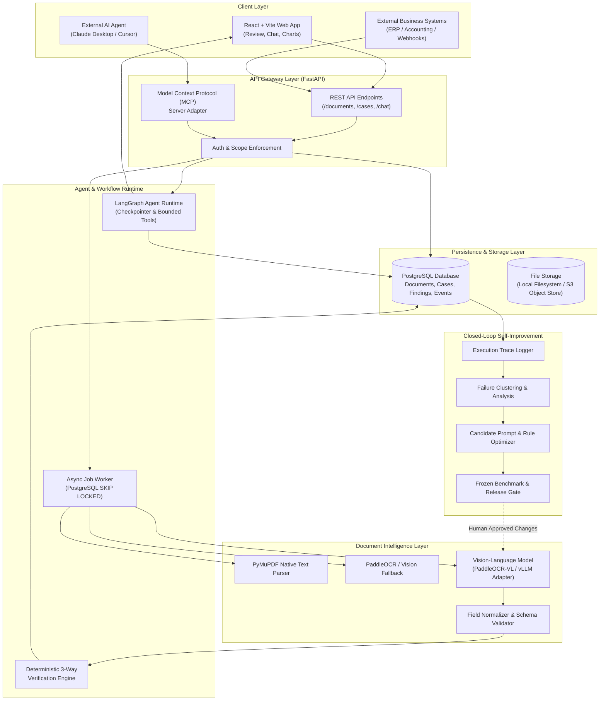
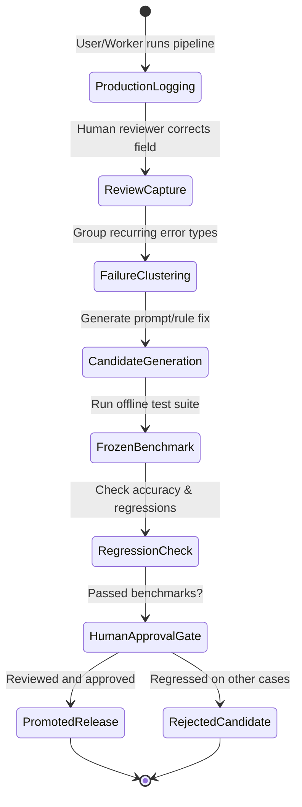
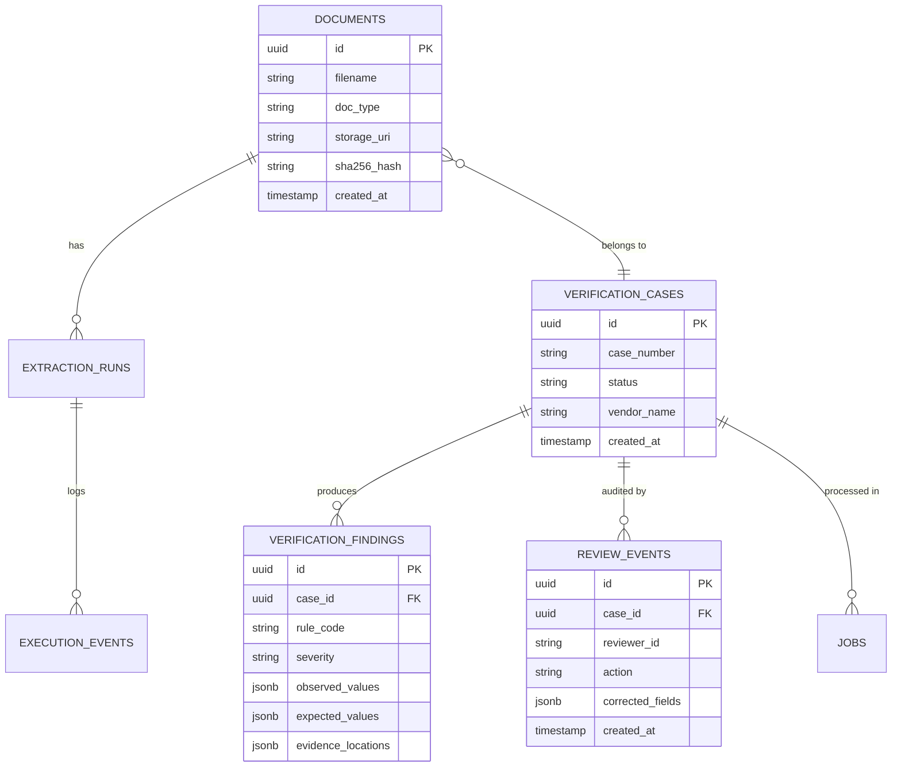

# ProofFlow AI — System Architecture & Component Design

> **Architecture Pattern**: Modular Monolith with Asynchronous Background Processing and Event Logging.  
> **Target Audience**: AI Systems Engineers, Software Architects, and Technical Reviewers.

---

## 🏛️ High-Level System Architecture



---

## 🧩 Architectural Subsystems

### 1. Document Intelligence Pipeline
The document ingestion and extraction pipeline uses a **hierarchical routing strategy**:
1. **Digital Parsing (Tier 1)**: Ingests documents via PyMuPDF. High quality vector PDFs extract structured text, fonts, and bounding boxes instantaneously at zero inference cost.
2. **OCR Fallback (Tier 2)**: For scanned or degraded pages, PaddleOCR extracts localized words with confidence scores.
3. **Multimodal VLM Extraction (Tier 3)**: When dealing with ambiguous multi-row tables, skewed columns, or hand-annotated forms, the page image is routed through an open-weight VLM (e.g. PaddleOCR-VL or Qwen-2.5-VL via vLLM) with strict Pydantic JSON schemas.
4. **Provenance & Grounding**: Every extracted field retains an immutable citation:
   $$\text{Evidence} = \{\text{document\_id}, \text{page\_number}, \text{bbox: } [x_0, y_0, x_1, y_1], \text{confidence}\}$$

---

### 2. Deterministic 3-Way Verification Engine
To eliminate financial hallucinations, business reconciliation is **strictly deterministic**:
- The LLM **never** calculates arithmetic sums or decides whether quantities match.
- Calculations use Python's `Decimal` module for precision.
- The engine checks:
  $$\text{Ordered Quantity} \iff \text{Received Quantity} \iff \text{Billed Quantity}$$
  $$\text{Agreed Unit Price} \iff \text{Billed Unit Price}$$
  $$\sum (\text{Qty} \times \text{Price}) + \text{Tax} = \text{Total Billed}$$
- Findings are emitted as structured discrepancies with explicit severity levels (`HIGH`, `MEDIUM`, `LOW`, `INFO`).

---

### 3. Agentic Runtime (LangGraph)
The conversational layer ("Talk with your data") is governed by a **bounded LangGraph agent**:
- Operates under a strict read-only execution context.
- Equipped with a limited tool registry:
  - `get_case(case_id)`: Fetches full bundle state and verification status.
  - `list_findings(case_id, severity)`: Inspects specific discrepancies.
  - `search_documents(keyword, vendor)`: Queries indexed document text.
  - `get_metrics(metric_name, dimension, time_range)`: Retrieves validated database aggregates.
- **Safety Invariants**:
  - Maximum 4 tool iterations per question.
  - No direct SQL code generation or raw query execution.
  - Mandatory evidence citations for every numerical assertion.

---

### 4. Model Context Protocol (MCP) Integration
ProofFlow exposes its verification capabilities to external AI systems (such as Claude Desktop, Cursor, and enterprise agents) via a standardized MCP server implementation in `apps/mcp/`:

```json
{
  "tools": [
    {
      "name": "proofflow_get_case",
      "description": "Retrieve verification findings, line items, and audit states for a document case.",
      "parameters": {
        "type": "object",
        "properties": {
          "case_id": { "type": "string" }
        },
        "required": ["case_id"]
      }
    },
    {
      "name": "proofflow_get_metrics",
      "description": "Query approved aggregate metrics (e.g., mismatch rates, vendor discrepancy count).",
      "parameters": {
        "type": "object",
        "properties": {
          "metric": { "type": "string", "enum": ["mismatch_rate", "volume", "cycle_time"] },
          "vendor": { "type": "string" }
        },
        "required": ["metric"]
      }
    }
  ]
}
```

---

### 5. Closed-Loop Self-Improvement Engine



#### Key Tenets of Self-Improvement:
1. **Never autonomous in production**: Changes are proposed offline as versioned pull requests or configuration candidates.
2. **Immutable benchmark sets**: Optimization algorithms never run against the held-out test dataset.
3. **Comprehensive delta scoring**: Candidate prompts must prove zero regression on critical financial fields across historical benchmark cases.

---

## 🗄️ Database Architecture (PostgreSQL)


