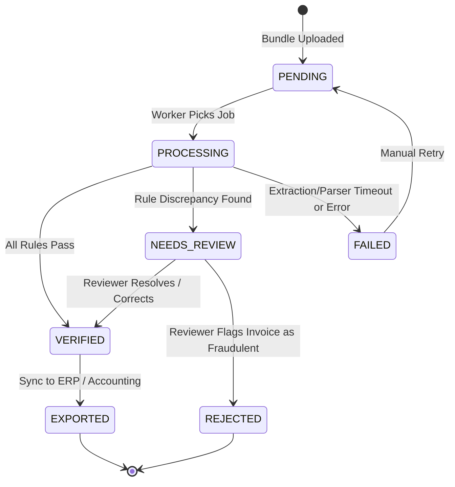

# ProofFlow AI — Product Specification, Domain Rules & API Contracts

> **Version**: 0.1.0-MVP  
> **Status**: Approved Baseline  
> **Target Audience**: Backend Engineers, Frontend Engineers, and QA.

---

## 🎯 Product Specification

### Target Persona
**The Accounts Payable (AP) & Procurement Auditor**:
- Handles hundreds of invoices, purchase orders (POs), and goods-received notes (GRNs) each month.
- Spends 15–30 minutes manually cross-checking line items, quantities, and totals across multi-page scans.
- Needs an automated system that flags only real discrepancies with exact visual proof, freeing them from repetitive manual verification.

### Core User Journey
1. **Upload**: User uploads a document bundle containing an Invoice, a Purchase Order, and a Goods-Received Note.
2. **Processing**: System asynchronously extracts text, structures line items, grounds values to source pages, and executes 3-way reconciliation.
3. **Review**: 
   - If clean: Marked `VERIFIED` and ready for export.
   - If discrepancy found: Flagged as `NEEDS_REVIEW` with visual side-by-side evidence and bounding boxes.
4. **Correction & Audit**: User can adjust an erroneously extracted field, which updates the finding state and logs an immutable audit event.
5. **Conversational Insights**: User can ask questions ("What is the total discrepancy across Vendor X this month?") and view generated charts.

---

## 📐 Canonical Domain Schemas

### 1. Document Extraction Schema (`CanonicalDocument`)

```json
{
  "$schema": "http://json-schema.org/draft-07/schema#",
  "title": "CanonicalDocument",
  "type": "object",
  "required": ["document_id", "document_type", "vendor_name", "items", "total_amount"],
  "properties": {
    "document_id": { "type": "string", "format": "uuid" },
    "document_type": { "type": "string", "enum": ["INVOICE", "PURCHASE_ORDER", "GOODS_RECEIPT"] },
    "document_number": { "type": "string" },
    "issue_date": { "type": "string", "format": "date" },
    "currency": { "type": "string", "default": "USD" },
    "vendor_name": { "type": "string" },
    "purchase_order_reference": { "type": ["string", "null"] },
    "items": {
      "type": "array",
      "items": {
        "type": "object",
        "required": ["item_description", "quantity", "unit_price", "line_total"],
        "properties": {
          "line_number": { "type": "integer" },
          "item_sku": { "type": ["string", "null"] },
          "item_description": { "type": "string" },
          "quantity": { "type": "number" },
          "unit_price": { "type": "number" },
          "line_total": { "type": "number" },
          "evidence": {
            "type": "object",
            "properties": {
              "page": { "type": "integer" },
              "bbox": {
                "type": "array",
                "items": { "type": "number" },
                "minItems": 4,
                "maxItems": 4
              }
            }
          }
        }
      }
    },
    "subtotal": { "type": "number" },
    "tax_amount": { "type": "number" },
    "total_amount": { "type": "number" }
  }
}
```

---

## ⚖️ Verification Rules Engine

The deterministic verification engine evaluates the following canonical rules:

| Rule Code | Rule Name | Description | Severity | Trigger Condition |
| :--- | :--- | :--- | :--- | :--- |
| `R-001` | **Supplier Identity Match** | Vendor on Invoice matches Vendor on referenced PO. | `HIGH` | Levenshtein normalized similarity < 0.85. |
| `R-002` | **Quantity Reconciliation** | Invoiced quantity $\le$ Goods-Received quantity. | `HIGH` | $\text{Invoice Qty} > \text{Received Qty}$. |
| `R-003` | **Unit-Price Agreement** | Invoiced unit price matches PO agreed price. | `HIGH` | $|\text{Invoice Price} - \text{PO Price}| > 0.01$. |
| `R-004` | **Mathematical Consistency** | Line items and tax correctly sum to the declared total. | `MEDIUM` | $|\sum (\text{Qty} \times \text{Price}) + \text{Tax} - \text{Total}| > 0.02$. |
| `R-005` | **Duplicate Detection** | Invoice number from same vendor has not been processed. | `CRITICAL` | Same `(vendor_name, document_number)` in DB. |
| `R-006` | **Missing Reference** | Invoice references a PO number that is absent in the bundle. | `MEDIUM` | Referenced PO ID is missing or unregistered. |

---

## 🔄 State Machine Transitions



---

## 📡 REST API Specifications

### Base URL: `/api/v1`

| Method | Endpoint | Description | Request Payload | Response |
| :--- | :--- | :--- | :--- | :--- |
| `POST` | `/documents` | Upload a PDF or image file | `multipart/form-data` (`file`, `doc_type`) | `201 Created` (`document_id`, `sha256`) |
| `GET` | `/documents/{id}` | Get document metadata & extraction | None | `200 OK` (`CanonicalDocument`) |
| `POST` | `/cases` | Group documents into a case bundle | `{ "document_ids": ["uuid..."], "vendor": "..." }` | `201 Created` (`case_id`, `status: "PENDING"`) |
| `POST` | `/cases/{id}/verify` | Trigger async 3-way reconciliation | None | `202 Accepted` (`job_id`) |
| `GET` | `/cases/{id}` | Retrieve case verification status & findings | None | `200 OK` (Full Case + Findings payload) |
| `POST` | `/cases/{id}/reviews` | Submit reviewer correction or approval | `{ "action": "APPROVE", "corrections": [...] }` | `200 OK` (Updated Case status) |
| `GET` | `/jobs/{id}` | Poll background processing status | None | `200 OK` (`status`, `progress_percent`) |
| `POST` | `/chat/query` | Ask natural language question to agent | `{ "query": "Why was case 101 flagged?" }` | `200 OK` (`answer`, `citations`, `chart_spec`) |
| `GET` | `/analytics/metrics` | Fetch aggregated analytics | Query params: `metric`, `start_date`, `end_date` | `200 OK` (`data_points: [...]`) |
| `POST` | `/feedback` | Log extraction error for self-improvement | `{ "case_id": "...", "field": "...", "ground_truth": "..." }` | `201 Created` |

### Sample Response: `GET /api/v1/cases/{id}`

```json
{
  "case_id": "550e8400-e29b-41d4-a716-446655440000",
  "case_number": "CASE-2026-0042",
  "status": "NEEDS_REVIEW",
  "vendor_name": "Apex Electronics Ltd.",
  "created_at": "2026-10-11T16:00:00Z",
  "documents": [
    { "id": "doc-01", "type": "INVOICE", "number": "INV-8891" },
    { "id": "doc-02", "type": "PURCHASE_ORDER", "number": "PO-1044" },
    { "id": "doc-03", "type": "GOODS_RECEIPT", "number": "GRN-0921" }
  ],
  "findings": [
    {
      "finding_id": "fnd-01",
      "rule_code": "R-002",
      "rule_name": "Quantity Reconciliation",
      "severity": "HIGH",
      "item_description": "Mechanical Keyboard - Blue Switches",
      "observed": {
        "invoiced_quantity": 120,
        "ordered_quantity": 100,
        "received_quantity": 100
      },
      "discrepancy": "+20 units billed beyond goods received",
      "evidence": [
        {
          "document_id": "doc-01",
          "page": 1,
          "bbox": [140.5, 312.0, 182.0, 328.5]
        },
        {
          "document_id": "doc-03",
          "page": 1,
          "bbox": [145.0, 290.0, 185.0, 305.0]
        }
      ]
    }
  ]
}
```
